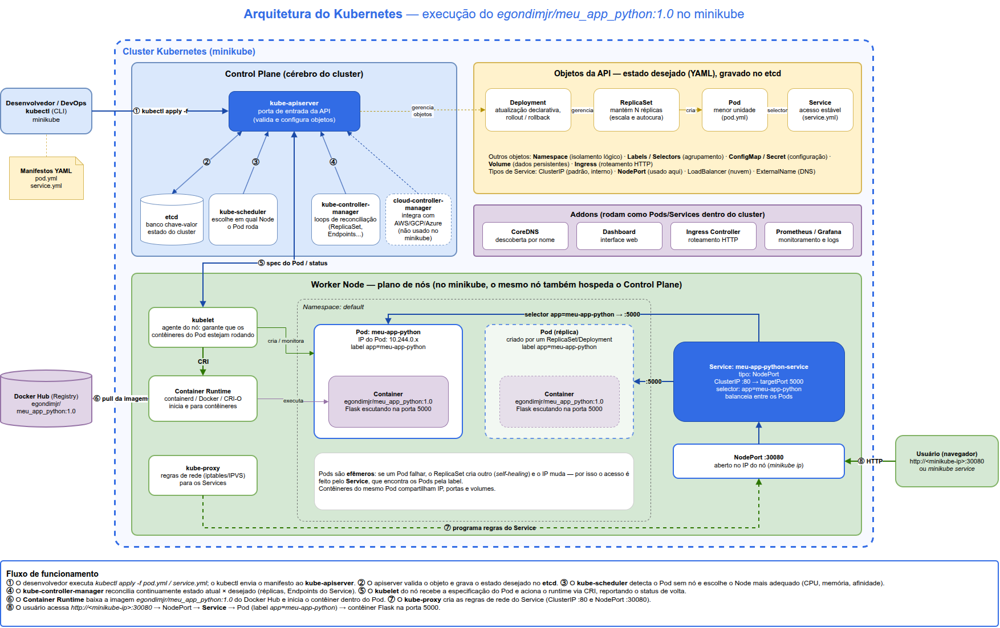

# Arquitetura Kubernetes

Atividade do curso de DevOps: desenho da arquitetura do Kubernetes no draw.io, descrição dos seus componentes e execução de um **Pod** e de um **Service** no **minikube**, usando a imagem própria [`egondimjr/meu_app_python:1.0`](https://hub.docker.com/r/egondimjr/meu_app_python).

Base teórica: *Slides – Unidade 9* (Aula 25 – Orquestração: Docker Swarm e Kubernetes).

## Estrutura

```
arquitetura_kubernetes/
├── kubernetes.drawio      # desenho da arquitetura (abrir com a extensão "Draw.io Integration" do VS Code)
├── kubernetes.png         # exportação do desenho em imagem
├── README.md              # este arquivo
├── pod.yml                # manifesto do Pod
├── service.yml            # manifesto do Service (NodePort)
├── executar_minikube.sh   # script que executa tudo e salva as evidências
└── artefatos/             # logs e prints da execução no minikube
```

## Diagrama



## O que é o Kubernetes

O Kubernetes (K8s) é o orquestrador de contêineres que virou padrão de mercado. Ele automatiza a implantação, a escala, a rede e a disponibilidade de aplicações em contêineres. Funciona de forma **declarativa**: você descreve em YAML o estado desejado e o cluster trabalha o tempo todo para que o estado real fique igual a ele. Daí vêm a **alta disponibilidade** e o **self-healing** (autocura).

Um **cluster** tem duas partes: o **Control Plane**, que toma as decisões, e os **Nodes**, que rodam as aplicações.

## Control Plane (plano de controle)

O "cérebro" do cluster. Toma as decisões administrativas e garante que o estado real corresponda ao desejado.

| Componente | Função |
|---|---|
| **kube-apiserver** | Porta de entrada do cluster: expõe a API do Kubernetes. É o único componente com o qual todos os outros falam diretamente. Valida e configura os objetos (Pods, Services etc.). O `kubectl` conversa com ele. |
| **etcd** | Banco de dados chave-valor, distribuído e consistente, que guarda todo o estado e a configuração do cluster. |
| **kube-scheduler** | Observa os Pods recém-criados que ainda não têm nó e escolhe em qual **Node** cada um vai rodar. Leva em conta CPU, memória, afinidade/antiafinidade e taints/tolerations. |
| **kube-controller-manager** | Executa os controladores, que são loops de reconciliação: comparam o estado atual com o desejado e corrigem a diferença. Exemplos: o Replication Controller (mantém o número de réplicas) e o Endpoint Controller (liga Services aos Pods). |
| **cloud-controller-manager** | Integra o cluster com provedores de nuvem (AWS, GCP, Azure), por exemplo para criar balanceadores de carga. Não é usado no minikube. |

## Node Plane (nós de trabalho)

Máquinas (físicas ou virtuais) que executam os contêineres. No minikube, um único nó faz o papel de Control Plane e de Worker.

| Componente | Função |
|---|---|
| **kubelet** | Agente que roda em cada nó. Recebe do API Server a especificação dos Pods e garante que os contêineres estejam rodando. Também reporta o status de volta ao Control Plane. Fala com o runtime pela **CRI** (Container Runtime Interface). |
| **kube-proxy** | Proxy de rede de cada nó. Mantém as regras (iptables/IPVS) que fazem o tráfego enviado ao IP de um Service chegar, com balanceamento, aos Pods certos. |
| **Container Runtime** | Software que de fato baixa as imagens e inicia/para os contêineres (containerd, CRI-O, Docker). |

## Objetos do Kubernetes

| Objeto | Descrição |
|---|---|
| **Pod** | Menor unidade que pode ser implantada. Encapsula um ou mais contêineres que compartilham o mesmo IP, as portas e os volumes. É **efêmero**: quando falha, é destruído e recriado ("gado, não pet"), e o novo Pod tem outro IP. |
| **Service** | Dá um ponto de acesso **estável** (IP e nome DNS fixos) a um grupo de Pods e balanceia o tráfego entre eles. Escolhe os Pods pelas **labels** (`selector`). |
| **ReplicaSet** | Controlador que mantém sempre um número definido de Pods idênticos rodando (escala e autocura). Raramente é criado direto: normalmente é gerenciado por um Deployment. |
| **Deployment** | Abstração de nível mais alto que gerencia ReplicaSets. Permite atualizações declarativas (Rolling Update ou Recreate) e **rollback** para versões anteriores. |
| **Namespace** | Divisão lógica do cluster para isolar recursos (ex.: `default`, `kube-system`). |
| **Labels / Selectors** | Pares chave=valor (ex.: `app: meu-app-python`) usados para agrupar e selecionar objetos. |

### Tipos de Service

| Tipo | Uso |
|---|---|
| **ClusterIP** (padrão) | IP virtual interno, acessível só de dentro do cluster. Serve para a comunicação entre microsserviços. |
| **NodePort** | Expõe o Service numa porta fixa (30000–32767) de cada nó: `http://<IP-do-nó>:<NodePort>`. **É o tipo usado nesta atividade.** |
| **LoadBalancer** | Em nuvem, cria um balanceador externo com IP público. |
| **ExternalName** | Mapeia o Service para um nome DNS externo (registro CNAME). |

### Addons

Componentes que estendem o cluster e rodam como Pods dentro dele: **CoreDNS** (descoberta de serviços por nome), **Dashboard** (interface web), **Ingress Controller** (roteamento HTTP) e **Prometheus/Grafana** (monitoramento e logs).

## Ferramentas

| Ferramenta | Descrição |
|---|---|
| **kubectl** | CLI oficial para interagir com o cluster: envia manifestos ao API Server (`apply`), consulta recursos (`get`, `describe`), vê logs (`logs`) etc. |
| **minikube** | Cria um cluster Kubernetes local, de um nó só, para estudo e testes. |
| **Docker Hub** | Registry público de onde o runtime baixa a imagem `egondimjr/meu_app_python:1.0`. |

## Fluxo de funcionamento (numeração do diagrama)

1. `kubectl apply -f pod.yml` envia o manifesto ao **kube-apiserver**.
2. O apiserver valida o objeto e grava o estado desejado no **etcd**.
3. O **kube-scheduler** vê o Pod sem nó e escolhe o Node.
4. O **kube-controller-manager** reconcilia o estado (réplicas, Endpoints do Service).
5. O **kubelet** do nó recebe a spec do Pod e aciona o runtime via CRI.
6. O **Container Runtime** baixa a imagem do Docker Hub e inicia o contêiner.
7. O **kube-proxy** cria as regras de rede do Service (ClusterIP :80 e NodePort :30080).
8. O usuário acessa `http://<minikube-ip>:30080`. O tráfego passa pelo NodePort, depois pelo Service, e chega ao Pod, no contêiner Flask na porta 5000.

## Manifestos

### `pod.yml`

Pod `meu-app-python` com um contêiner da imagem `egondimjr/meu_app_python:1.0` (aplicação Flask na porta **5000**), com a label `app: meu-app-python` e limites de CPU e memória.

### `service.yml`

Service `meu-app-python-service` do tipo **NodePort**. Seleciona os Pods com `app: meu-app-python` e encaminha: porta **80** do Service → **5000** do contêiner. Por fora, o acesso é pela porta **30080** do nó.

## Como executar no minikube

Pré-requisitos: [minikube](https://minikube.sigs.k8s.io/docs/start/) e [kubectl](https://kubernetes.io/docs/tasks/tools/) instalados, além do Docker (driver do minikube).

```bash
minikube start

kubectl apply -f pod.yml
kubectl apply -f service.yml

kubectl get pods -o wide --show-labels
kubectl get svc meu-app-python-service
kubectl describe pod meu-app-python
kubectl logs meu-app-python

# URL de acesso (abre no navegador)
minikube service meu-app-python-service
# ou
curl http://$(minikube ip):30080
```

Resposta esperada: `Atividade Docker + Vagrant concluída!`

Também dá para rodar tudo de uma vez e gravar as saídas em `artefatos/`:

```bash
chmod +x executar_minikube.sh
./executar_minikube.sh
```

> Se o driver do minikube for `docker` (Linux/macOS/Windows), o IP do nó pode não ser acessível direto do host. Nesse caso, use a URL que o `minikube service meu-app-python-service --url` mostra (ele abre um túnel).

Para remover:

```bash
kubectl delete -f service.yml -f pod.yml
minikube stop
```

## Artefatos da execução

Ficam em [`artefatos/`](artefatos/):

- `execucao_*.log`: saída dos comandos (`minikube start`, `kubectl apply`, `get`, `describe`, `logs`, `curl`);
- `navegador_service.png`: página servida pelo Service em `http://192.168.59.100:30080`;
- prints do terminal e do navegador acessando o Service.

Ambiente da execução: minikube v1.39.0 (driver VirtualBox), Kubernetes v1.37.0 e kubectl v1.37.1, no Ubuntu 26.04. Resumo:

```
$ kubectl get pods -o wide --show-labels
NAME             READY   STATUS    RESTARTS   AGE   IP           NODE       LABELS
meu-app-python   1/1     Running   0          8s    10.244.0.3   minikube   app=meu-app-python

$ kubectl get svc meu-app-python-service
NAME                     TYPE       CLUSTER-IP       EXTERNAL-IP   PORT(S)        AGE
meu-app-python-service   NodePort   10.100.141.160   <none>        80:30080/TCP   8s

$ curl -s http://192.168.59.100:30080
Atividade Docker + Vagrant concluída!
```

## Integrantes

| Nome | GitHub |
|---|---|
| Emanuel Gondim | [@egondimjraws](https://github.com/egondimjraws) |
| Rafael Albuquerque | [@rafael-albuquerque07](https://github.com/rafael-albuquerque07) |

Repositório: <https://github.com/egondimjraws/Aponti-FAP-Kubernetes>
